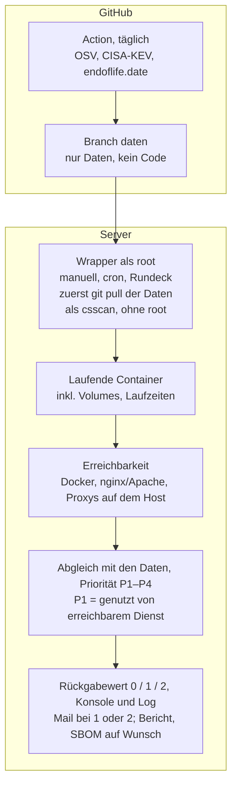

# container-security-scan

Schwachstellen-Scan für **laufende Docker-Container**. Gemeldet wird vor allem, was ein von außen erreichbarer
Dienst tatsächlich nutzt. Eine Python-Datei, nur Standardbibliothek, ab Python 3.6, rein lesend; Paketlisten verlassen den Server
nie.

Was Image-Scanner wie Trivy oder Grype nicht sehen:

- Anwendungen in **Volumes** (z. B. PHP samt `vendor/`), **eingebettete JavaScript-Bibliotheken** (jQuery 1.x)
- **Laufzeiten aus offiziellen Images** (PHP, Node.js, Python aus dem Quellcode gebaut, ohne OS-Paket)
- welcher Dienst eine Komponente lädt und ob er **erreichbar** ist – auch hinter Reverse Proxys
  (nginx → Apache → php-fpm), im Nachbarcontainer oder direkt auf dem Host

## So sieht ein Lauf aus

```bash
sudo /usr/local/sbin/container-security-scan-lauf
```

Ausschnitt aus dem Lauf über die [Testumgebung](beispiele/umgebung/compose.yml) (nginx vor PHP-FPM und Node.js;
vollständig: [Konsolenausgabe](beispiele/ausgabe.txt)):

```
container-security-scan 1.0.0
Scan: 2026-11-24 16:00 UTC
Daten: 2026-11-24 13:43 UTC
Host: <rechner> mit 4 laufenden und 0 gestoppten Containern:
- app-node     erstellt 2026-11-24 16:00 UTC, läuft seit 0 min
…

=== app-php ===
WARNUNG: Supportende: jquery 1.12.4 (jquery 1, Datum unbekannt; /srv/app/public/js/jquery-1.12.4.min.js)
RELEVANTE SCHWACHSTELLEN – 1437 Befunde, davon 65 relevant (65 neu, 4 aktiv ausgenutzt), P1 ohne Schweregrad: 1
Image php:8.3.30-fpm-bookworm – Debian GNU/Linux 12 (bookworm)
Dienst php-fpm 8.3.30 (in /var/www/html), Port 9000: öffentlich über nginx:80 in app-proxy
  Webadressen: http://shop.example.org:8080/ (\.php$)
CVE-2026-111497 (CRITICAL KEV) in libbrotli1 1.0.9-2+b6 – behoben in 1.0.9-2+deb12u1 – genutzt von php-fpm:9000 – aktiv ausgenutzt (KEV seit 2026-10-27)
CVE-2026-33845 (CRITICAL) in libgnutls30 3.7.9-2+deb12u6 – behoben in 3.7.9-2+deb12u7 – genutzt von php-fpm:9000
…
CVE-2026-109618 (CRITICAL KEV) in php 8.3.30 – behoben in 8.3.36 – genutzt von php-fpm:9000 – aktiv ausgenutzt (KEV seit 2026-10-26)
…
CVE-2022-29248 (HIGH) in guzzlehttp/guzzle 7.4.0 – behoben in 7.4.3 – genutzt von php-fpm:9000 (Docroot unbekannt)
…
P1 ohne Schweregrad (nicht gezählt, bitte selbst einschätzen):
DLA-4783-1 (UNKNOWN) in liblzma5 5.4.1-1 – behoben in 5.4.1-1+deb12u2 – genutzt von php-fpm:9000

=== app-node ===
WARNUNG: Öffentlicher Dienst node:3000 läuft als root (UID 0, ohne unprivilegierte Worker) – eine Lücke darin gibt root im Container; Benutzer setzen (user:, USER) oder non-root-Image
…

Gesamt: 4 Container geprüft – RELEVANTE FUNDE (Schwachstellen bzw. gefährliche Einstellungen)
ERGEBNIS: FUNDE (Rückgabewert 1) – <rechner>
```

- Von 1437 Befunden sind 65 **relevant**: php-fpm ist über nginx erreichbar (Priorität P1), die Lücken sind
  schwer bzw. aktiv ausgenutzt (`KEV`), und es gibt einen Fix.
- Je Container nennt die Ausgabe Image, [Dienste](#ausgabe) mit dem Proxy davor und die
  [Webadressen](#webadressen); darunter jeder relevante Fund mit Schweregrad und Fix-Version.
- [Warnungen](#warnungen) wie „läuft als root“ ändern den Rückgabewert nicht, [gefährliche
  Einstellungen](#gefährliche-einstellungen-des-containers) wie ein eingebundener `docker.sock` schon.
- Auf Wunsch je Container ein Bericht mit allen Befunden, Prozessen und Webserver-Konfiguration
  ([Beispiel](beispiele/scan_app-php.md)) und eine SBOM ([CycloneDX](beispiele/scan_app-node.cdx.json)).

## Installation und Betrieb

Der Scan läuft als root, deshalb sind Code und Daten getrennt. Den **Code** installiert root von Hand aus einem
Release (Git-Tag). Die **Daten** holt der Benutzer `csscan` ohne Rechte bei jedem Lauf per `git pull` aus dem
Branch [`daten`](https://github.com/dla-marbach/container-security-scan/tree/daten).



```
/opt/container-security-scan/                  Code (container-security-scan.py)
/var/lib/container-security-scan/daten/        Daten (Branch daten, Benutzer csscan)
/usr/local/sbin/container-security-scan-lauf   Wrapper: Daten aktualisieren, dann scannen
/etc/container-security-scan/ausnahmen.txt     Ausnahmeliste
/var/log/container-security-scan/              Logs; unter berichte/ Stand für „NEU“ und Berichte
```

### Einrichten

Voraussetzungen: Linux mit Docker, Python ≥ 3.6, `git`, `curl`; optional `rpm` (nur für RPM-Container ohne
eigenes `rpm`).

Das [Installscript](installation/installieren.sh) aus dem
[aktuellen Release](https://github.com/dla-marbach/container-security-scan/releases/latest) holen, lesen und
ausführen:

```bash
V=vX.Y.Z      # Version des Releases
curl -fsSO https://raw.githubusercontent.com/dla-marbach/container-security-scan/$V/installation/installieren.sh
less installieren.sh
sudo bash installieren.sh $V
# mit Proxy (gilt auch für das git pull der Daten): sudo env https_proxy=http://proxy:3128 bash installieren.sh $V
```

Es bricht ab, bevor es etwas ändert, wenn `$V` kein Tag ist oder nicht zur Version im Code passt. Code und
[Wrapper](installation/container-security-scan-lauf) ersetzt es jedes Mal; Benutzer, Daten und
[Ausnahmeliste](installation/ausnahmen.txt) legt es nur an, wenn sie fehlen.

Optional mit geprüfter Signatur des Tags (Schutz gegen eine Übernahme des GitHub-Kontos). Das Installscript
bricht ab, wenn der Tag nicht auf den angegebenen Commit zeigt:

```bash
# Schlüssel des Maintainers vorher importieren: https://github.com/felixlohmeier.gpg
git clone -q https://github.com/dla-marbach/container-security-scan.git /tmp/css && cd /tmp/css \
  && git verify-tag $V && git checkout -q $V \
  && sudo bash installation/installieren.sh $V "$(git rev-parse HEAD)"
```

### Scannen

```bash
sudo /usr/local/sbin/container-security-scan-lauf                 # alle laufenden Container
sudo /usr/local/sbin/container-security-scan-lauf app-php         # nur dieser Container
sudo /usr/local/sbin/container-security-scan-lauf 'surveyor_*'    # alle passenden (Muster mit * und ?)
sudo /usr/local/sbin/container-security-scan-lauf --bericht app-php   # dazu Bericht (auch --sbom)
```

Auch bei einer Auswahl ermittelt der Scan die Erreichbarkeit über alle laufenden Container (nur Prozesse, Ports
und Proxy-Konfiguration, wenige Sekunden je Container); die Ergebnisse sind dieselben wie im Gesamtlauf. Muster
in Anführungszeichen setzen, sonst ersetzt die Shell sie ggf. durch Dateinamen. Passt kein laufender Container,
ist das Ergebnis `2`. Optionen (`--mail`, `--bericht`, `--sbom`) stehen vor den Containern.

### Täglich per cron oder Rundeck

Die Daten werden täglich um 03:17 UTC aktualisiert (oft bis zu einer Stunde später); den Scan danach ansetzen.

cron (`/etc/cron.d/container-security-scan`, Mail an root nur bei Rückgabewert 1 oder 2):

```cron
MAILTO=""
23 7 * * * root /usr/local/sbin/container-security-scan-lauf --mail >/dev/null 2>&1
```

Rundeck darf per sudo nur den Wrapper ohne Argumente starten (`""` verbietet Argumente):

```bash
echo 'rundeck ALL=(root) NOPASSWD: /usr/local/sbin/container-security-scan-lauf ""' > /etc/sudoers.d/rundeck-container-scan
chmod 440 /etc/sudoers.d/rundeck-container-scan && visudo -c
```

- Job-Schritt „Command“ (nicht „Script“): `sudo -n /usr/local/sbin/container-security-scan-lauf`; bei
  `requiretty` zusätzlich `Defaults:rundeck !requiretty`.
- Zeitlimit großzügig (bis zu 30 Minuten je Container); Server auf demselben Host nacheinander.
- 1 und 2 sind in Rundeck beide rot; die letzte Zeile `ERGEBNIS: FUNDE` bzw. `ERGEBNIS: UNVOLLSTAENDIG`
  unterscheidet sie.
- Optional den SSH-Schlüssel auf den Befehl festlegen (`~rundeck/.ssh/authorized_keys`):
  `command="sudo -n /usr/local/sbin/container-security-scan-lauf",from="<IP>",no-pty,no-port-forwarding,no-agent-forwarding,no-X11-forwarding ssh-ed25519 AAAA…`

### Auf das Ergebnis reagieren

| Rückgabewert | `ERGEBNIS:` | Bedeutung | Zu tun |
|---|---|---|---|
| `0` | `OK` | nichts Relevantes gefunden | nichts |
| `1` | `FUNDE` | relevante Schwachstellen oder [gefährliche Einstellungen](#gefährliche-einstellungen-des-containers) | Funde ansehen (neue sind markiert), Images aktualisieren, Einstellungen beheben; Fehlalarme und akzeptierte Risiken in die [Ausnahmeliste](#ausnahmen) |
| `2` | `UNVOLLSTAENDIG` | **Prüfung unvollständig – nie als „sauber“ werten** | Meldung lesen und Ursache beheben |

Gründe für `2` sind z. B.: Docker nicht erreichbar, Daten fehlen oder sind 3 Tage oder älter, Dateien, Prozesse
oder Webserver-Konfiguration nicht vollständig lesbar (auch die eines Proxys auf dem Host), Distribution ohne
Sicherheitsupdates (Supportende) oder nicht unterstützt (z. B. Oracle Linux), Ausnahmeliste fehlerhaft.
Keine Paketdatenbank ist nur bei einem Image ganz ohne Betriebssystem kein Grund (`FROM scratch` mit statischem
Programm wie Portainer: kein `os-release`, keine Shell, keine gemeinsam genutzten Bibliotheken); ein Image mit
BusyBox ohne Paketdatenbank bleibt unvollständig.

[Warnungen](#warnungen) (Supportende, Dienst als root …) ändern den Rückgabewert nicht. Der Server selbst (seine
Pakete und Dienste) ist nicht Teil des Scans, siehe [Abgrenzung](#abgrenzung-und-grenzen).

### Aktualisieren

1. Änderungen ansehen: Hinweise im Release und `…/compare/vA.B.C...vX.Y.Z`. Die installierte Version nennen jedes
   Log und `python3 /opt/container-security-scan/container-security-scan.py --version`.
2. Das Installscript des neuen Releases wie unter [Einrichten](#einrichten) ausführen. Daten, Ausnahmeliste und
   Berichte bleiben; eigene Änderungen am Wrapper werden ersetzt.

Ein automatisches Update des Codes gibt es bewusst nicht.

### Ohne Zugriff auf GitHub

Soll GitHub nicht die Datenquelle sein, lädt `csscan` die Daten direkt von den Quellen (OSV, endoflife.date,
CISA). Dafür ohne Branch `daten` installieren:

```bash
sudo env DATEN= bash installieren.sh $V
```

Erreicht der Server `github.com` gar nicht, den Tag auf einem anderen Rechner als Bundle verpacken:

```bash
git clone -q https://github.com/dla-marbach/container-security-scan.git css && git -C css bundle create ../css.bundle $V
git -C css show $V:installation/installieren.sh > installieren.sh     # beides auf den Server kopieren, dort:
sudo env REPO=$PWD/css.bundle DATEN= bash installieren.sh $V
```

Nach jeder Installation im Wrapper die Zeilen mit `git pull` und `ARGS=` ersetzen:

```bash
  runuser -u csscan -- python3 -I "$CODE" --db "$D/osv-db" --db-aktualisieren \
      || { echo "FEHLER: Daten nicht aktualisiert (direkt von OSV)"; exit 2; }
ARGS=(--db "$D/osv-db")
```

Der erste Lauf lädt ca. 1,25 GB, danach meist 30–40 MB pro Tag; bei vielen Änderungen lädt er den Gesamtexport
eines Ökosystems neu (Ubuntu ca. 800 MB, etwa ein- bis zweimal pro Woche). Die Ergebnisse sind gleich, das
Einlesen dauert länger (Ubuntu ca. 30 statt 5 s je Container).

## Ergebnis verstehen

### Priorität und Relevanz

| | Komponente genutzt von … |
|---|---|
| **P1** | einem erreichbaren Dienst (siehe [Erreichbarkeit](#erreichbarkeit)) |
| **P2** | einem Dienst mit nur internem Port |
| **P3** | einem Prozess ohne offenen Port |
| **P4** | keinem erkannten Prozess, oder Entwicklungsabhängigkeit |

**Relevant** (Rückgabewert 1) sind P1 CRITICAL/HIGH und P2 CRITICAL (`RELEVANT` im Skript) sowie jede **aktiv
ausgenutzte Lücke** aus dem [KEV-Katalog der CISA](https://www.cisa.gov/known-exploited-vulnerabilities-catalog),
auch als P4 – Programme wie ImageMagick oder ffmpeg laufen nur bei Bedarf. Der Wrapper zählt nur Funde mit Fix
(`--nur-behebbare`). Nicht relevant sind Funde aus der Ausnahmeliste, Funde ohne Schweregrad (in P1 einzeln
aufgeführt, zum selbst Einschätzen) und Lücken, die laut Titel nur Windows betreffen.

„Genutzt von“ ermittelt der Scan aus `/proc` (Programm, geladene Bibliotheken, offene Dateien und Ports) und für
npm/Composer/PyPI über das Projektverzeichnis (Arbeitsverzeichnis, Skriptpfad, venv, Docroot des Webservers).

Schweregrad: Einstufung der Distribution, sonst der Quelle, sonst CVSS.
Fehlt er, gilt die Bewertung derselben CVE aus den Bitnami- bzw. Alpine-Daten, markiert mit `*` (`CRITICAL*`).
Kernel-Pakete werden nicht geprüft (Container nutzen den Kernel des Hosts).

### Erreichbarkeit

„Öffentlich“ heißt: von außerhalb des Servers erreichbar. Internet und Intranet sind auf dem Server nicht zu
unterscheiden und zählen gleich; eine Testumgebung mit derselben Konfiguration liefert dieselben Funde.
Grundsatz: **im Zweifel erreichbar.** Erkannt werden:

- veröffentlichte Ports (auch an `127.0.0.1`), Host-Netzwerk, eigene Adresse im LAN (macvlan, ipvlan, geroutet),
  gemeinsamer Netzwerk-Namespace (`network_mode: container:…`)
- Backends eines erreichbaren nginx oder Apache – im Container oder direkt auf dem Host, auch über mehrere Stufen
  (`proxy_pass`, `fastcgi_pass`, `upstream`, `ProxyPass`, `SetHandler proxy:`, `RewriteRule … [P]`, Variablen aus
  `set`/`map`), Ziel per Container-Name, IP, `127.0.0.1` (auch `0.0.0.0`) oder Unix-Socket (der Prozess im selben
  Container, der darauf lauscht), bei einem Proxy im Netzwerk des Hosts auch per eigener Adresse des Hosts
  (veröffentlichter Port bzw. der Prozess, der dort lauscht); gibt es einen Namen mehrfach (Compose-Dienst `app` in zwei Projekten), zählt zuerst ein
  Container in einem gemeinsamen Netz mit dem Proxy, dann einer aus demselben Compose-Projekt; nginx vor 1.9.2
  (ohne `-T`): Hauptdatei und `include`-Dateien liest der Scan selbst
- Ziele eines erreichbaren stunnel (`connect` je Dienst, auch mit `include`)
- Ziele aus Traefik- und caddy-docker-proxy-Labels
- Container, die eine erreichbare Anwendung aufruft (Ziel-URLs in Umgebung oder Kommandozeile, offene
  Verbindungen); Datenbanken, Caches und Message Broker als Ziel zählen nicht
- Tunnel-Agenten (cloudflared, frpc, ngrok, chisel)
- **möglicherweise erreichbar** (mit Warnung): Container im Docker-Netz eines Proxys, dessen Ziele nicht
  vollständig bekannt sind (Traefik, Caddy, HAProxy, Envoy, Varnish; nginx mit nicht auflösbarer Variable)

Ein Dienst, der nur auf Loopback lauscht, ist nur über einen Proxy mit demselben Loopback erreichbar.

Ein Proxy **direkt auf dem Host** (nginx, Apache, stunnel, Tunnel-Agent außerhalb von Docker) gilt als erreichbar, wenn er
nicht nur auf Loopback lauscht; eine Firewall des Hosts wird nicht ausgewertet. Seine Ziele erscheinen auf der
Konsole als `Host: …`. Die Prozesse des Hosts liest der Scan nur als root vollständig, sonst warnt er.

### Webadressen

Zur Orientierung, unter welcher Adresse ein Dienst mit Funden erreichbar ist; ohne Einfluss auf Priorität und
Rückgabewert. Aus der Konfiguration von nginx (`listen`, `server_name`, `ssl`) und Apache (vHosts aus `httpd -S`
samt `ServerAlias`, `SSLEngine`, `Listen` des Hauptservers) bildet der Scan je Website die Webadressen, z. B.
`https://www.example.org/`; ohne Namen `*`, mit dem veröffentlichten Port statt des Ports im Container.

Leitet ein Webserver einen Pfad weiter (`location /app/ { proxy_pass http://127.0.0.1:8080/; }`, `ProxyPass`,
`SetHandler proxy:fcgi://…`), erscheint die Adresse mit Pfad beim Ziel, auch über mehrere Stufen und Container:
`https://www.example.org/app/ (\.php$)` bei php-fpm hinter Apache hinter nginx. Das gilt ebenso für einen Proxy
direkt auf dem Host vor einem Container (per Container-IP, Name oder veröffentlichtem Port auf Loopback bzw. einer
eigenen Adresse des Hosts).

Auf der Konsole stehen sie unter jedem Dienst in einer Zeile `Webadressen: …`, zuerst die erreichbaren, dann
„nicht von außen“ (wie der Port, über den die Anfrage hereinkommt); `über …` nennt den Weg, wenn er nicht schon
in der Dienstzeile steht (z. B. ein weiterer Proxy auf dem Host). Im Bericht stehen sie je Adresse mit Weg, in
der SBOM als `endpoints`. Ein Fund gehört über „genutzt von“ zu seinem
Dienst. Die Adressen stammen aus der Konfiguration, nicht aus dem DNS.

### Gefährliche Einstellungen des Containers

Einstellungen, mit denen aus einer Lücke im Container root auf dem Host wird. Sie sind **immer relevant**, auch
mit `--nur-behebbare`:

| Kennung | Befund |
|---|---|
| `CONF-PRIVILEGED` | `--privileged` |
| `CONF-SOCKET` | `docker.sock`, `containerd.sock` oder `podman.sock` eingebunden, auch über ein Verzeichnis wie `/run` oder `/` und auch mit `:ro` |
| `CONF-PID-HOST` | `pid=host` |
| `CONF-CAP-…` | Capability `ALL`, `SYS_ADMIN`, `SYS_MODULE`, `SYS_RAWIO`, `DAC_READ_SEARCH` oder `BPF` (z. B. `CONF-CAP-SYS-ADMIN`) |
| `CONF-SECCOMP-UNCONFINED`, `CONF-APPARMOR-UNCONFINED` | Schutzprofil abgeschaltet |
| `CONF-HOST-PFAD` | Systempfad des Hosts beschreibbar eingebunden: `/etc` (oder Teile wie `shadow`, `sudoers`, `cron*`), `/root`, `/boot`, `/bin`, `/sbin`, `/lib*`, `/usr`, `/proc`, `/sys`, `/dev`, `/home` bzw. `~/.ssh`, `/var/lib/docker` |

Typischer Fall ist ein Werkzeug für Monitoring oder Deployment mit `docker.sock`: besser einen Socket-Proxy mit
Lesezugriff vorschalten (z. B. `tecnativa/docker-socket-proxy`), sonst eine [Ausnahme](#ausnahmen) mit dem
Containernamen.

### Warnungen

Ohne Einfluss auf den Rückgabewert, auf der Konsole und im Bericht:

- **Öffentlicher Dienst als root**, z. B. Node oder Python (nginx, Apache und php-fpm mit unprivilegierten
  Workern nicht, auch wenn deren Sockets nicht lesbar sind; sshd nicht; entfällt mit userns-remap oder rootless
  Docker).
- **Datenbank, Cache oder Message Broker direkt erreichbar** (z. B. `ports: ["5432:5432"]`): `ports:` entfernen
  oder an `127.0.0.1` binden.
- **Supportende** bzw. Supportende in den nächsten 90 Tagen (Daten von [endoflife.date](https://endoflife.date))
  für Bibliotheken und Frameworks (Laravel, Symfony, Django, jQuery, Spring, Log4j …) und für Laufzeiten und
  Server, die nicht aus einem OS-Paket stammen. Bei OS-Paketen zählt der Support der Distribution.
- Proxy nicht vollständig auswertbar, veraltete EOL- oder KEV-Daten.

### Ausnahmen

Für Fehlalarme und bewusst akzeptierte Risiken. Datei `/etc/container-security-scan/ausnahmen.txt` (root, nur
für root beschreibbar; anfangs nur auskommentierte [Beispiele](installation/ausnahmen.txt)):

```
# Kennung       Paket oder *  gültig bis  Begründung
CVE-2024-8926   php           2027-06-30  betrifft nur PHP-CGI unter Windows (geprüft 2026-11-05)
CONF-SOCKET     monitoring    2027-03-31  liest nur den Status der Container, Socket-Proxy geplant
```

- Paket wie in der Ausgabe bzw. der Spalte „Paket“ des Berichts; bei `CONF-…` der Containername.
- Nach dem Ablaufdatum zählt der Fund wieder (mit Warnung). Ausgenommene Funde stehen im Bericht unter „Nicht
  gezählt“.
- Eine fehlerhafte Zeile ergibt Rückgabewert 2, statt still etwas auszublenden.

### Ausgabe

Auf der Konsole (Rundeck, Log, Mail) zuerst Version, Zeitpunkt des Scans, Stand der Daten (älteste
Aktualisierung) und der Host (Hostname) mit der Zahl der laufenden, pausierten und gestoppten Container, die
laufenden mit Erstellung, Laufzeit, Healthcheck und Neustarts, dazu Proxys direkt auf dem Host (`Host: …`).
Geprüft werden nur laufende Container; pausierte (`docker pause`) und gestoppte nicht (ein pausierter zählt aber
für die Erreichbarkeit mit, etwa wenn ein laufender Container seinen Netzwerk-Namespace nutzt). Danach je Container ein
Abschnitt `=== <container> ===`. Bringt ein später geprüfter Proxy einen weiteren Weg oder weitere Webadressen zu
einem schon geprüften Container, prüft der Scan ihn erneut; die Überschrift nennt dann den Anlass, und dieser
Abschnitt ersetzt den früheren:

- Warnungen
- Ergebnis mit der Zahl der Befunde und der relevanten
- `Image …` mit Betriebssystem
- `Dienst …` je Prozess mit offenem Port: Programm und Version (Skript ohne Optionswerte, Arbeitsverzeichnis),
  Ports und wie sie erreichbar sind (`Port 9000: öffentlich über nginx:80 in app-proxy`); darunter die
  [Webadressen](#webadressen), bei einem Proxy die Ziele (`leitet weiter an: …`), bei einer Anwendung die
  aufgerufenen Container (`ruft auf: …`)
- [gefährliche Einstellungen](#gefährliche-einstellungen-des-containers) (`CONF-…`)
- relevante Funde, eine Zeile je Fund: Kennung, Schweregrad, Paket und Version, Fix-Version, genutzt von, aktiv
  ausgenutzt (KEV); neue zuerst mit `NEU:`, wenn ein Fund im letzten Lauf noch nicht relevant war
- unter `P1 ohne Schweregrad (nicht gezählt, bitte selbst einschätzen):` die P1-Funde, die noch keinen Schweregrad
  haben, gleiches Format (mit `--nur-behebbare` nur mit Fix)

Dateien im Ausgabeverzeichnis, nur für den Aufrufer lesbar:

| Datei | Wann | Inhalt |
|---|---|---|
| `bekannt_<container>.json` | jeder Lauf außer Rückgabewert 2 | relevante Funde des letzten Laufs, für die Markierung „NEU“ |
| `scan_<container>_<zeit>.md` | `--bericht` | Bericht: relevante Funde und Warnungen, Dienste mit Ports, Webadressen, alle Befunde nach Priorität, nicht gezählte Funde, Prozesse mit Kommandozeilen (oft mit Passwörtern), Webserver-Konfiguration |
| `….cdx.json` | `--sbom` | SBOM (CycloneDX 1.5), auch mit Trivy, Grype oder Dependency-Track nutzbar |
| `….sha256` | `--bericht` oder `--sbom` | Prüfsummen |

Bis 0.6.x schrieb jeder Lauf Bericht und SBOM; die alten Dateien `scan_*` unter
`/var/log/container-security-scan/berichte/` können gelöscht werden, `bekannt_*.json` bleiben.

## Aufruf ohne Wrapper

Für Sonderfälle; nutzt die vorhandenen Daten, ohne sie zu aktualisieren:

```bash
C=/opt/container-security-scan/container-security-scan.py; DB=/var/lib/container-security-scan/daten
sudo python3 -I $C --db $DB --alle-container --nur-behebbare <ausgabeverzeichnis>             # wie der Wrapper
sudo python3 -I $C --db $DB --bericht --alle --container 'app-*' <ausgabeverzeichnis>        # Auswahl, Bericht mit allen Befunden
```

| Option | Bedeutung |
|---|---|
| `--alle-container` | alle laufenden Container, zuerst die erreichbaren und die Backends ihrer Proxys |
| `--oeffentliche` | nur die erreichbaren Container und deren Backends |
| `--container MUSTER` | nur passende Container (Name, ID oder Muster wie `surveyor_*`, mehrfach möglich; auch ohne Option als erstes Argument), Erreichbarkeit wie im Gesamtlauf |
| `--nur-behebbare` | nur Funde mit Fix zählen – empfohlen, sonst melden ungepatchte Lücken dauerhaft `1` |
| `--bericht` | je Container einen [Bericht](#ausgabe) schreiben (Markdown) |
| `--sbom` | je Container eine SBOM schreiben (CycloneDX 1.5) |
| `--alle` | mit `--bericht`: alle Befunde in die Tabelle (sonst P3/P4 nur CRITICAL/HIGH/KEV) |
| `--ausnahmen DATEI` | [Ausnahmeliste](#ausnahmen) |
| `--db DIR` | Datenverzeichnis; mehrfach möglich, je Ökosystem gilt das erste, das es enthält. Standard: `daten/` und `osv-db/` neben dem Skript |
| `--db-aktualisieren` | Daten holen (nie als root, nie den Code): im Git-Checkout den Branch `daten` nach `daten/`; ohne Git-Checkout oder mit `--db DIR` alle Daten direkt von den Quellen; `--oekosysteme A,B` lädt weitere Ökosysteme (z. B. SUSE, openSUSE) nach `osv-db/`, `--voll` alles neu |
| `--user` | Benutzer für `docker exec` (Standard `0`); ein anderer kann meist nicht alles lesen (dann `2`) |
| `--version` | Version anzeigen |

## Was geprüft wird

| Bereich | Quelle | Abgleich |
|---|---|---|
| OS-Pakete | dpkg, apk, rpm, inkl. Quellpaket | Debian, Ubuntu, Alpine (optional SUSE, openSUSE) |
| npm | `package.json` | npm |
| Composer | `vendor/composer/installed.json` | Packagist |
| PyPI | `*.dist-info`, `*.egg-info` (auch venvs) | PyPI |
| Java | JAR/WAR/EAR, auch verschachtelt | Maven |
| Go | Build-Info in Go-Programmen | Go |
| JavaScript | eingebettete Bibliotheken (jQuery, Bootstrap, Moment, Vue …) | npm |
| Laufzeiten, Server | Version von node, php, php-fpm, python, java, nginx, apache, mariadb, postgresql | Distribution, sonst (offizielle Images, nginx.org, NodeSource, Sury, mariadb.org) OSV Bitnami |

Nutzerdaten werden nicht ausgewertet: Dateien im Datenverzeichnis von Nextcloud (mit `.ocdata` bzw. `.ncdata`) lässt der Scan
mit `find`/`tar` schon im Container weg. Beim passiven Lesen (ohne Werkzeuge oder Leserechte im Container, über
`docker export` und `docker cp`) gelangen sie zum Scanner und werden dort im Speicher verworfen. Der Bericht nennt
das Verzeichnis.

**Daten** (Branch [`daten`](https://github.com/dla-marbach/container-security-scan/tree/daten), täglich von
[`daten.yml`](.github/workflows/daten.yml) erzeugt, ca. 365 MB): ein Auszug aus den OSV-Exporten mit nur den
Feldern und Einträgen, die der Abgleich liest (Ergebnisse identisch mit den vollständigen Exporten), dazu Supportende
(endoflife.date) und KEV-Katalog (CISA). Quellen und Lizenzen:
[`QUELLEN.md`](https://github.com/dla-marbach/container-security-scan/blob/daten/QUELLEN.md).

## Rein lesend

- Im Container laufen nur `find`/`tar` und ein sh-Skript, das `/proc` liest, über einen festen Suchpfad statt
  den `PATH` des Images. `docker diff` zeigt vor und nach dem Scan keine Änderung.
- Versionsabfragen (`node -e`, `php -r` …, mit Zeitlimit), `nginx -T` bzw. `apache2 -S` und das Lesen der
  Konfiguration von nginx ohne `-T` und stunnel laufen **nie mit mehr Rechten als der jeweilige Prozess** bzw. der
  Hauptprozess des Webservers.
- Einzige Ausnahme: stunnel liest seine Konfiguration als root und wechselt dann per `setuid` den Benutzer (unter
  SUSE ist `/etc/stunnel` nur für root lesbar). Kann der Prozess sie deshalb nicht lesen, liest der Scan sie als
  root, aber nur, wenn die Datei, ihre include-Dateien und alle Verzeichnisse darüber root gehören, weder für die
  Gruppe noch für andere beschreibbar sind und kein symbolischer Link darin vorkommt; dabei laufen nur `sh`,
  `find` und `cat`, nie stunnel selbst. Sonst gilt die Konfiguration als nicht lesbar (Rückgabewert 2).
- Ohne Shell im Container wird passiv gelesen (`docker export`, `docker cp`, `/proc` des Hosts); nichts wird auf
  dem Host entpackt.
- Es werden nur Daten heruntergeladen; Paketlisten verlassen den Server nie.

## Abgrenzung und Grenzen

Das Werkzeug beantwortet eine Frage: **Welche laufenden Dienste sind erreichbar, und welche verwundbaren
Komponenten nutzen sie?** Nicht vorgesehen sind allgemeine Härtung (CIS-Benchmarks, HTTP-Header, TLS-Versionen,
Statusseiten, no-new-privileges …), Prüfungen der Konfiguration von Diensten und der Server selbst: Dessen
Pakete und Dienste deckt der Patch-Prozess der Distribution ab (z. B. `zypper patch`); `--host` aus 0.4.x ist
deshalb wieder entfallen.
Dafür gibt es z. B. [Trivy](https://trivy.dev), [Grype](https://github.com/anchore/grype),
[Vuls](https://github.com/future-architect/vuls) oder [Kubescape](https://kubescape.io).

Bekannte Grenzen:

- Nicht erkannt: Rust, Ruby, .NET, Tcl, Programme ohne Versionskennung, JavaScript-Bundles ohne Kopfkommentar,
  Fremdpaketquellen außer den genannten.
- Welche Pakete eine Anwendung tatsächlich importiert, ist von außen nicht sichtbar.
- Nur nginx, Apache und stunnel werden als Proxy ausgewertet; andere machen ihre Nachbarn „möglicherweise“ erreichbar
  (eher zu viel). Ziele, die nur in Konfigurationsdateien einer Anwendung stehen (z. B. Spring
  `application.yml`), fehlen, wenn gerade keine Verbindung besteht.
- Das `httpd` von BusyBox gilt als Webserver ohne Weiterleitungen; stehen welche (`P:`) in seiner
  Konfiguration (`-c` bzw. `/etc/httpd.conf`) oder ist sie nicht lesbar, ist die Prüfung unvollständig.
- Apache: `.htaccess` wird nicht ausgewertet.
- Webadressen: Eine weitergeleitete Adresse gilt für alle Websites am Port des Ziels (welche antwortet,
  entscheidet der Host-Header; im Zweifel eine Adresse zu viel). Über mehrere Stufen werden die Pfade
  aneinandergehängt; das stimmt, wenn das Ziel den Pfad `/` hat (`proxy_pass http://mitte/;`), sonst nicht
  (`proxy_pass http://mitte/dienst/` und dort `location /dienst/api/` ergibt `/app/dienst/api/` statt
  `/app/api/`). Adressen aus Traefik- und Caddy-Labels fehlen.
- Supportende nur für Produkte mit Paketkennung und die genannten Laufzeiten, nicht für einzelne OS-Pakete,
  Java-Laufzeiten oder Anwendungen wie WordPress.

## Entwicklung und Tests

Nur auf einem eigenen Testrechner, nicht auf Servern:

```bash
git clone https://github.com/dla-marbach/container-security-scan.git && cd container-security-scan
./container-security-scan.py --db-aktualisieren                              # Daten nach daten/ (nicht als root)
sudo ./container-security-scan.py --alle-container --nur-behebbare --bericht berichte/

python3 -m unittest discover -s tests                                        # Unit-Tests, ohne Docker
CSS_DOCKER_TESTS=1 python3 -m unittest discover -s tests -p test_docker.py   # mit Docker und daten/
sudo bash beispiele/erzeugen.sh                                              # Beispiele neu erzeugen
```

- Was welche Testdatei prüft: [`tests/README.md`](tests/README.md). Die Action
  [`tests.yml`](.github/workflows/tests.yml) führt die Unit-Tests mit Python 3.6 (älteste unterstützte) und 3.14 aus, den Docker-Test
  bei Pull Requests und auf `main`.
- [Beispiele](beispiele/) im selben Pull Request neu erzeugen, wenn sich `VERSION` oder das Format der Berichte
  ändert (ein Test prüft die Version). Das Skript startet die Testumgebung
  [`beispiele/umgebung/`](beispiele/umgebung/).
- Änderungen unter `installation/` aus einem Tag des committeten Stands ausprobieren (in einem temporären
  Klon, die eigenen Tags bleiben unberührt):

  ```bash
  V=v$(./container-security-scan.py --version | cut -d" " -f2) && rm -rf /tmp/css && git clone -q . /tmp/css
  git -C /tmp/css tag -f $V && git -C /tmp/css bundle create /tmp/css.bundle $V
  sudo env REPO=/tmp/css.bundle bash installation/installieren.sh $V && sudo /usr/local/sbin/container-security-scan-lauf
  ```

### Releases

Server installieren nur Git-Tags `vX.Y.Z` auf `main`. Die Version steht nur in `VERSION` in
`container-security-scan.py`. Jeder Pull Request, der den Code oder `installation/` ändert, erhöht sie: `Z` bei
Korrekturen ohne Einfluss auf Ergebnisse, `Y` bei neuen Funktionen oder anderer Bewertung, `X` bei inkompatiblen
Änderungen (Rückgabewerte, `ERGEBNIS: …`, Optionen, Schritte für Admins).

1. Im Pull Request: `VERSION` erhöhen, Beispiele neu erzeugen.
2. Nach dem Merge den Merge-Commit taggen und pushen: `git tag -s v0.2.0 -m v0.2.0 <commit> && git push origin v0.2.0`
   (die Action prüft, dass der Tag zu `VERSION` passt).
3. Auf GitHub ein Release anlegen und darin nennen, was Admins wissen müssen (Voraussetzungen, Rückgabewerte,
   Wrapper).

### Repository auf GitHub (Rulesets)

Damit das Token des Workflows nur die Daten ändern kann:

| Ruleset bzw. Einstellung | Regeln |
|---|---|
| Branch `main` | *Restrict deletions*, *Block force pushes*, *Require a pull request before merging*; optional *Require status checks* und *Require signed commits*; keine *Bypass list* für GitHub Actions |
| Branch `daten` | *Restrict deletions*, *Block force pushes* (die Action committet direkt) |
| Tags `v*` | *Restrict creations* (nur *Repository admin*), *Restrict updates*, *Restrict deletions* |
| *Actions → General → Workflow permissions* | *Allow GitHub Actions to create and approve pull requests* aus |

Gegen eine Übernahme des Kontos hilft das nicht, sondern nur der Blick auf die Änderungen vor jedem Update und die
Signatur des Tags.
